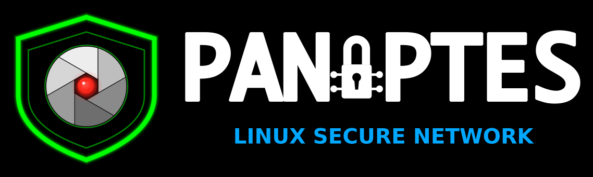

<p align="center">
  
</p>

# Panoptes

**Linux Secure Network**

Private DNS, a Cloudflare WARP kill-switch with a Proton VPN fallback, and
network intrusion detection for Linux. The all-seeing network watch.

[](https://github.com/doug445/Panoptes/actions/workflows/lint.yml)
[](LICENSE)
[](LICENSE)
[](#dependencies)
[](#notes-and-caveats)
[](#dns--auditing-hardening-leak-prevention)
[](#tunnel--cloudflare-warp-that-can-never-blackhole-the-machine-with-proton-vpn-behind-it)
[](#endpoint--outbound-firewall-and-persistence-watch)

**A Linux network security suite: encrypted, filtered DNS (AdGuard over DoT
with DNSSEC, Quad9 and Cloudflare behind it), Encrypted Client Hello in every
browser that can do it, a Cloudflare WARP tunnel with a verified kill-switch
and self-healing watchdog, Proton VPN as the fallback tunnel with WARP parked
safely underneath it, a two-icon system-tray control for the resolver and the
tunnels, monitors that watch firewalld drops and the ARP table for port scans
and spoofed gateways, an outbound application firewall (OpenSnitch) and a
persistence watch (osquery) that lists what runs at boot or login and tells
you when that changes — plus deep investigation of any address that touches
the machine.** This is a a comprehensive Endpoint Detection and Response (EDR) 
hardening framework for Linux. Twenty-three command-line tools. One installer sets it all up,
including its dependencies, the Proton VPN client and the endpoint pair, on
Fedora, Debian, Ubuntu, Mint, Arch and openSUSE, on x86_64 and aarch64.

Built and used daily on **Fedora** , a portable **Linux Mint** (MATE) stick,
**Manjaro**, **EndeavourOS**, **Debian/Ubuntu** and **Fedora
Asahi Remix** (Apple Silicon). Nothing in it is tied to one machine: the
distribution, package manager, Wi-Fi interface, desktop toolkit and tunnel
clients are all read at run time. Anything running **systemd-resolved** and
**NetworkManager** is in scope; the list above is where it has been run, not
a limit.

## Why Panoptes

Argus Panoptes, "the all-seeing", was the giant of Greek myth with a hundred
eyes. Hera set him to guard Io, whom Zeus had hidden as a heifer, because he
never slept: while some of his eyes rested, the rest kept watch, so nothing
crossed the ground he guarded unseen. It took Hermes a whole night of stories
and flute-playing to close every eye at once before he could kill him, and
Hera set the hundred eyes in her peacock's tail so they would never be lost.
That is the job this suite does for a Linux system: eyes on the resolver, the
tunnel, the ARP table and the firewall log at the same time, and no moment
when all of them are closed. The macOS sibling,
[Panoptes-macOS](https://github.com/doug445/Panoptes-macOS), is the same
watchman rebuilt on `networksetup`, `scutil`, `pf` and launchd.

## Why this exists

Most network trouble on a modern Linux desktop is not a routing problem. It is a
*DNS* problem wearing a routing problem's clothes: your VPN pushed its own
resolver, DHCP quietly overrode the one you configured, `systemd-resolved` is
answering from a per-link server you never chose, or a kill-switch left an
`nftables` table behind after the daemon died.

These tools were written one outage at a time, each after a real failure that
took hours to diagnose by hand. `netmaster` exists because a Wi-Fi link
associated fine, LAN worked, and the internet was simply gone — and stayed gone
across reboots. `probesource` exists because "who is 5.42.x.x and why is it
knocking" deserved a better answer than four terminals of `whois`, `dig` and
`tcpdump`. `warp-killswitch` exists because a WARP daemon that dies, or wedges,
leaves a firewall with policy DROP behind it and the machine goes dark while
every indicator says "connected". `proton-fallback` exists because raising a
second tunnel over a merely-disconnected WARP is how that wedge happens.

## What Encrypted Client Hello is, and why it matters

HTTPS encrypts what you send and receive. It does not encrypt **which site you
are talking to**. The very first packet of a TLS handshake — the ClientHello —
carries the hostname in a field called SNI, in the clear, before any encryption
exists. Anyone on the path reads it: your ISP, the coffee-shop router, the
hotel network, a national firewall, a corporate middlebox.

That single field is how most real-world web filtering and logging works. Not by
breaking encryption — by reading the label on the envelope.

People usually plug the DNS half of this leak first, with DNS-over-HTTPS or
DNS-over-TLS, and reasonably conclude they are covered. They are not. Encrypting
your lookups hides the *question*; SNI still announces the *answer* a few
milliseconds later, on every single connection.

**ECH closes that hole.** The site publishes a public key in a DNS `HTTPS`
record. Your browser encrypts the real ClientHello — hostname included — to that
key, and wraps it in an outer one naming only the provider. An observer sees a
connection to `cloudflare-ech.com`, or whatever the front is, and cannot tell
which of the millions of sites behind it you asked for.

### The DNS half is not optional

ECH and secure DNS are one mechanism, not two features. Your browser has to
fetch that `HTTPS` record to learn the key at all — so if the lookup travels in
plaintext, the name leaks there instead and the key can be stripped by anyone
who wants to force a fallback. Firefox will not even attempt ECH with TRR
disabled. This is why `ech-browsers.sh` sets both together, and why turning on
"ECH" alone in `about:config` accomplishes nothing.

### What it does not do

Worth being straight about, because ECH is easy to oversell:

- **The destination IP is still visible**, unless you are also behind a VPN.
  Behind a large CDN that reveals little, since thousands of sites share the
  address; a site on a dedicated IP is identified by the address alone, and ECH
  does not help. Run a tunnel such as WARP and the destination goes inside it,
  out of your ISP's view — but that moves the visibility rather than removing
  it, since the tunnel operator now sees both ends. With WARP specifically,
  that operator is Cloudflare, who is already the other end of most
  ECH-enabled connections.

  Split-tunnel excludes are the case people forget: any host or range you
  exclude travels outside the tunnel, so its IP is visible to the network again
  and ECH is the only thing still hiding the hostname. Check yours with
  `warp-cli settings`.
- **It needs the site's cooperation.** Only sites publishing an ECH config get
  the protection. Cloudflare-fronted sites largely do; much of the web does not
  yet.
- **Traffic analysis survives it.** Sizes and timings still say things.
- **Some networks block it**, either deliberately or through middleboxes that
  choke on an unfamiliar handshake.

None of that is an argument against it. ECH removes the cheapest, most widely
harvested identifier in your traffic, at no cost to you once it is on. It raises
the price of passive surveillance from "read the field" to "run real analysis" —
and that difference is most of what privacy engineering ever buys.

### What this suite does about it

| | |
|---|---|
| **Check** | `checkdns` tests both layers — whether the DNS `HTTPS` record carries an ECHConfig, and whether a real TLS handshake with ECH succeeds. |
| **Get a capable client** | `ech-build.sh` builds an ECH-capable curl, because distribution curl packages cannot do ECH yet — OpenSSL gained it only in 4.0.0 (April 2026), and distributions still link curl against OpenSSL 3.x (Fedora 44 ships 3.5). |
| **Turn it on** | `ech-browsers.sh` enables ECH and the secure DNS it depends on in every browser on the machine. |

Verify any of it at [defo.ie/ech-check.php](https://defo.ie/ech-check.php).

---

## Quick start

```bash
git clone https://github.com/doug445/Panoptes.git
cd Panoptes
sudo ./install.sh
```

Then:

```bash
checkdns              # resolver, WARP, mDNS and ECH status in one readout
sudo audit-dns.sh     # what controls DNS here, and where a leak could get in
netcheck              # interfaces, Wi-Fi band/bitrate, firewall, listening ports
ech-browsers.sh       # turn on Encrypted Client Hello in every browser you have
sudo warp-setup.sh    # Cloudflare WARP: repository, client, registration, kill-switch service
proton-fallback on    # park WARP and bring Proton VPN up instead (sign in once first)
persistcheck          # everything persistent or exposed right now, and what changed since last time
```

The installer copies tools, installs dependencies after asking, installs the
Proton VPN client and the endpoint pair (OpenSnitch, osquery) after asking,
and wires the two tray helpers. The services it enables are the WARP watchdog
(only when WARP is installed), `opensnitch`, `osqueryd` and `persistwatch`.
`audit-dns.sh`, `netcheck`, `nettop`, `checkdns` and `dns-status.sh` are
strictly read-only.

---

## The tools

### DNS — auditing, hardening, leak prevention

| Tool | What it does |
|------|--------------|
| **`audit-dns.sh`** | Read-only audit of everything that can set DNS on the box: `systemd-resolved` global and per-link servers, NetworkManager connection overrides, `/etc/resolv.conf` and its symlink target, VPN pushed-DNS in WireGuard and OpenVPN configs, and `chattr` immutability. Prints where a **DNS leak** could get in. Run as root for full visibility — VPN configs are usually mode 600. |
| **`harden-dns.sh`** | Idempotent DNS hardening: enforces **DNSSEC**, **DNS-over-TLS (DoT)** with hostname pinning, and a fixed resolver policy across NetworkManager and `systemd-resolved`. Re-running changes nothing if already in the desired state. `--dry-run` supported. Policy is overridable by environment: `PRIMARY_DNS`, `FALLBACK_DNS`, `DOMAINS`, `DNSSEC_MODE`, `DOT_MODE`. The `chattr +i` lock on `resolved.conf` is restored on every exit path, including a failure or a Ctrl-C mid-write. |
| **`checkdns`** | One-screen status: which resolvers are live (annotated by provider), Cloudflare WARP state, Avahi/mDNS status, and **Encrypted Client Hello** verification at both layers — the DNS `HTTPS` record carrying the ECHConfig, and a real `curl --ech hard` handshake. |
| **`dns-toggle`** | Flips `systemd-resolved` between a filtering resolver (AdGuard) and a security-filtering one (Cloudflare `1.1.1.2`), handling the `chattr +i` immutability lock around `resolved.conf` and restoring it afterwards. |
| **`dns-status.sh`** | One-line current-resolver indicator, for status bars and tray applets. |
| **`dns-tray`** | System tray applet: shows the active resolver and toggles it on click. Daemonizes cleanly so closing the shell does not kill it. Reports a failed toggle instead of announcing a success it cannot verify. |

### Tunnel — Cloudflare WARP that can never blackhole the machine, with Proton VPN behind it

| Tool | What it does |
|------|--------------|
| **`warp-setup.sh`** | Installs and activates **Cloudflare WARP**, which no distribution packages — it adds Cloudflare's own repository (RPM or APT, signature checking on, the *base* codename on Mint, Pop!_OS and LMDE), installs the client, registers the device, connects, and then runs `warp-killswitch install` so the kill-switch service arrives with the tunnel. Sets `tunnel_only` mode by default and explains why: WARP's other modes proxy DNS themselves, which fights `harden-dns.sh`, `dns-toggle` and `checkdns`; `tunnel_only` carries traffic and leaves resolution to `systemd-resolved`. Asks before registering, since that creates a device record on Cloudflare's side. Every `warp-cli` call is time-bounded. `--check` reports state, `--mode` switches mode, `--uninstall` removes the client and the repository. |
| **`warp-killswitch`** | **Tear Down** (`down`): disconnect (time-bounded), stop *and disable* the daemon so it stays down across reboot, remove its v4 and v6 policy rules, every route it owns in every table, every `cloudflare-warp` nft table and the tun itself, drop DNS to plain `1.1.1.2` so a **captive portal** can intercept (`--keep-dns` leaves the resolver alone), then **prove** plain internet works and escalate until it does. **Rebuild** (`up`): restore DNS verbatim — relocking `resolved.conf` if it was immutable — re-enable, connect, wait for *Connected* **and** a raw-IP check, and roll back to a clean disconnected state if the tunnel never comes. **Park** (`park` / `unpark`): the teardown with DNS kept and a *parked* marker, so another tunnel can take the network and WARP comes back when it leaves. **Heal**: the decision procedure below, on demand. `install` writes the service pieces; `state` prints `parked`, `killed` or `armed`. |
| **watchdog** | `warp-killswitch watchdog` as a systemd service: every 10 s a raw-IP probe (parallel pings, then TCP 443 by address — no DNS). Link up but internet dead for three probes → `heal`, with back-off. Purges leftovers of a dead daemon; fixes a resolver that fails while IP works. Never acts while WARP is torn down or parked. A `warp-svc` drop-in runs `purge` after *any* daemon exit, clean or not, so a crash can never leave the DROP firewall behind; a system-sleep hook disconnects before suspend and reconnects after resume through a transient unit, because systemd kills anything a sleep hook leaves running. |
| **`proton-setup.sh`** | Installs the official **Proton VPN** Linux client — the desktop app, the official `protonvpn` CLI and the AppIndicator pieces its tray icon needs — from Proton's own repository, with Proton's signing key **pinned by fingerprint**. On APT it verifies the signed `InRelease`, the `Packages` index and the release package hash before `dpkg` sees anything; on Fedora it imports the pinned key and checks the release RPM's signature; the Arch family goes through an AUR helper already on the machine, and anything with Flatpak gets the Flathub build. Idempotent: a second run reports *unchanged* for every step. `--check`, `--dry-run`, `--uninstall`. Signing in is yours to do, once. |
| **`proton-fallback`** | Proton VPN as the fallback tunnel. `on` **parks WARP first** (`warp-killswitch park`), connects Proton VPN, waits for the tunnel and verifies it; `off` disconnects and, if WARP was parked, rebuilds it. Drives whichever client is present: the official CLI, a NetworkManager profile (`import` turns a WireGuard or OpenVPN file from account.proton.me into one, with Proton's pushed resolver stripped so `systemd-resolved` keeps its DoT policy over the tunnel), a wg-quick config, or the desktop app. `state` is cheap enough for a tray to poll. A WARP you tore down yourself is left down either way. |

**How `heal` decides.** Parked or torn down by you → nothing. Link down → not
WARP. Raw IP works → healthy (purge leftovers of a dead daemon; flush caches
if DNS alone fails). Offline with **no WARP artifacts** → upstream problem,
back off. Offline, **daemon dead, artifacts remain** → purge them. Offline with
a live daemon → clean disconnect; if the artifacts survive the daemon is wedged
→ hard teardown (DNS kept); if plain internet works and a **captive portal** is
intercepting → leave WARP off and say so; otherwise retry once and leave WARP
off on failure. Every path ends with a notification stating the verified
outcome; a manual *Heal now* reports even when there was nothing to fix.

**Switching between WARP and Proton VPN.** The two cannot share the machine:
when a second tunnel takes the network, a merely-disconnected WARP daemon
wedges with its lockdown firewall still loaded and raw internet dies. So
`proton-fallback on` **parks** the WARP stack — daemon stopped and disabled,
DNS untouched, the watchdog, heal and the sleep hooks standing by — before it
connects Proton VPN, and `off` rebuilds WARP afterwards. The park is a marker
beside the kill marker, so the tray can tell a park (orange, resumable) from a
deliberate teardown (red). The same pattern, on the same evidence, as the
macOS suite.

### The tray toggles

`dns-tray` and `warp-tray` put one-click control of the resolver and the
tunnels in the system tray. A left-click flips the state and a desktop
notification confirms what happened — or says why it did not. Both pick their
toolkit from `XDG_CURRENT_DESKTOP`: Qt on KDE Plasma, otherwise GTK —
`XApp.StatusIcon` where libxapp is installed (Cinnamon, MATE, XFCE on Mint and
its relatives), plain `Gtk.StatusIcon` everywhere else. The installer does not
enable autostart; add `~/.local/bin/dns-tray` and `~/.local/bin/warp-tray` to
your desktop's startup applications.


The icons use two colour conventions, on purpose. `warp-tray` is a real
on/off switch, so green means on and red means down. `dns-tray` is not: it
never turns DNS off, it swaps one encrypted resolver for another, so its other
state is yellow, not red — nothing is broken, you are simply on the other
resolver.

| Icon | Meaning |
|---|---|
| 🟢 green `AG` shield | AdGuard `94.140.14.14` / `.15.15` over DoT — ad and tracker filtering at the DNS layer |
| 🟡 yellow `C` shield | Cloudflare `1.1.1.2` security over DoT — malware filtering, no ad blocking, usually faster |
| 🟢 green `W` | Cloudflare WARP connected (tunnel-only) |
| 🔴 red `W` | WARP disconnected, or torn down by *Last Resort* |
| 🟠 orange `W` | WARP **parked** for Proton VPN, but Proton VPN is not connected (the app was quit, or it dropped). *Rebuild* brings WARP back. |
| 🟡 yellow circle, black `P` | **Proton VPN connected** — WARP is parked until you disconnect |

Both resolver lists end with Quad9 (`9.9.9.9`) as a cross-provider failover,
because `FallbackDNS=` cannot do that job — see the note below. Neither DNS
state is "DNS off"; the toggle handles the `chattr +i` lock on `resolved.conf`
for you.

| Tray | Action | What it does |
|---|---|---|
| **`dns-tray`** | left-click | `dns-toggle`: flip the resolver. Says so if the toggle could not run. |
| **`warp-tray`** | left-click | `warp-cli connect` / `disconnect`, time-bounded. Refused while Proton VPN is connected, and while WARP is torn down or parked (use *Rebuild*). |
| | 🔴 Last Resort: Tear Down | `warp-killswitch down`: the full verified teardown. DNS goes to plain `1.1.1.2` so a captive portal can intercept. |
| | 🟢 Rebuild WARP + restore DNS | `warp-killswitch up`. Refused while Proton VPN is connected. |
| | 🩺 Heal now | `warp-killswitch heal` — the decision procedure, now, with a result either way. |
| | ℹ️ Status | A notification with the helper's one-screen readout, plus the Proton VPN state. |
| | 🟡 Proton VPN: Connect (parks WARP first) | `proton-fallback on`. |
| | ⏹️ Proton VPN: Disconnect → rebuild WARP | `proton-fallback off`. |

Both trays reach their root helpers through `sudo -n`, so they need
passwordless rules. `sudo ./install.sh` writes them for the invoking user,
pinned to the exact invocations the trays make (see [What gets installed
where](#what-gets-installed-where)); without them the trays notify that the
action did not run instead of pretending it did.

> [!IMPORTANT]
> **Toggling WARP off drops every DNS lookup that is in flight at that moment.**
> The tunnel teardown itself is clean — the `nftables` table, the `ip rule` and
> the routing table all come down with it, and plain routing works immediately
> afterwards. What does not survive is any query already in progress: those fail
> DNSSEC validation with `failed-auxiliary`, because the transport carrying the
> DS and DNSKEY lookups disappeared mid-chain, and `systemd-resolved` caches the
> failure.
>
> The visible result is a browser insisting it is offline while the network is
> fine — Firefox's captive-portal probe is usually among the casualties, and a
> failed probe is enough for it to declare no connectivity.
>
> **`FallbackDNS=` will not save you, and this surprises people.** Per
> `resolved.conf(5)` it is *"only used if no other DNS server information is
> known"* — that is, only when `DNS=` is empty. It is **not** a failover for the
> servers in `DNS=` going quiet. If you want real resolver failover, list the
> extra servers in `DNS=` itself.
>
> Clearing the cached failures is enough to recover:
>
> ```bash
> resolvectl flush-caches
> ```
>
> Every tunnel transition in this suite — the trays, `proton-fallback`, the
> kill-switch — flushes for you and re-probes the per-server features. If WARP
> has genuinely wedged the network rather than just the cache,
> `warp-killswitch down` removes its `nftables` table, restores plain DNS and
> disables the daemon so it stays down across a reboot; `warp-killswitch up`
> puts it all back.

### Monitoring and investigation

| Tool | What it does |
|------|--------------|
| **`netwatch`** | Watches **firewalld** dropped packets, new inbound connections and **ARP anomalies**, and raises desktop notifications. Fingerprints the gateway and alerts when its MAC changes on the *same* network; a new SSID or a new gateway address re-baselines instead of alarming. Runs as a systemd service; resolves D-Bus so `notify-send` works from a unit; survives the kernel journal going away. Never triggers a Wi-Fi scan. |
| **`probesource`** | **The centrepiece.** Investigate any address — a firewall drop, a probe, a live connection. Pass one in as `probesource <ip>`, or pick a target from the UFW journal, the `netwatch` log, the live `ss` table, or type one in. Then run a single tactic, a one-pass sweep, or a relentless escalating sweep. Passive tactics: `whois`, reverse DNS, GeoIP, journal and `netwatch` history, neighbour table and OUI lookup, live socket state, conntrack, ipset membership, short `tcpdump`/`tshark` capture, and a `p0f` fingerprint listener. The target is validated once, at entry, as a strict IPv4 or IPv6 literal before any tactic sees it. |
| **`nettop`** | Lists hosts on the LAN and WAN with vendor attribution — active `arp-scan` for the LAN, falling back to `ip neigh` plus OUI lookup, with `whois` filling in vendor for public addresses. |
| **`netcheck`** | Read-only network status readout: every interface, Wi-Fi SSID, band, channel, frequency, protocol and bitrate for each adapter, MAC randomization state, firewall state, listening ports with the owning process, WARP state with an exit check, live DNSSEC and DoT verification, and cached `whois` for public addresses (private ranges are skipped). |

### Endpoint — outbound firewall and persistence watch

The Linux counterpart of the macOS suite's Objective-See component: LuLu,
KnockKnock and BlockBlock, rebuilt on two open-source tools that run on
x86_64 and aarch64 alike.

| Tool | What it does |
|------|--------------|
| **OpenSnitch** (installed by `endpoint-setup.sh`) | An outbound **application firewall**, the LuLu role: every program's first connection to a new destination raises a prompt, and the rule you choose is kept. firewalld and the kill-switch only cover inbound and the tunnel; this is what covers *outbound*. From the distribution on the Debian, Ubuntu and Arch families; on Fedora and openSUSE, which package neither it nor its UI, from upstream's GitHub release, verified against the maintainer's **signed** `readme.txt` (pinned key, SHA-512 per package). `endpoint-setup.sh` seeds *allow* rules for the suite's own traffic — `systemd-resolved`, NetworkManager, `warp-svc`, and the kill-switch watchdog's raw-IP pings and portal checks, pinned to their destinations — so a rebuild is never left waiting on a dialog, and starts the prompt UI with your session. |
| **osquery** (installed by `endpoint-setup.sh`) | The operating system as SQL tables, from osquery's own repository with the signing key **pinned by fingerprint** (one key serves APT, dnf and zypper). The suite ships a **persistence pack**: systemd units outside the distribution's directories, cron, autostart items, kernel modules, `ld.so.preload`, SSH authorized keys, sudoers rules, setuid binaries, network-exposed listeners with the process behind each, processes whose binary was deleted, the hashes of the system and per-user shell, dispatcher and drop-in hook files, and accounts. Your own `osquery.conf` is never overwritten: the suite keeps a copy of what it wrote and leaves an edited file alone. |
| **`persistcheck`** | The KnockKnock role, on demand: runs the pack's queries through `osqueryi` (via `sudo -n` when it can, so cron, keys and sudoers are complete) and prints everything, with `+`/`-` against the snapshot it took last time, so "what changed since I last looked" is one command. `--diff` for changes only, `--json` for the rows, `--baseline` to reset. Reads the installed pack, so it can never drift from what the watch watches. |
| **`persistwatch`** | The BlockBlock role, live: a root service that follows `osqueryd`'s results log and raises a desktop notification to every graphical session when the pack reports a new row — a new unit, cron entry, autostart item, module, key, sudoers rule, listener, deleted-binary process or changed hook file. Keeps its place across restarts and rotation; collapses a burst (the first pass after install lists everything that already exists) into one summary instead of a hundred dialogs. |

`endpoint-setup.sh` is idempotent (`--check`, `--dry-run`, `--yes`,
`--no-opensnitch`, `--no-osquery`), and `--uninstall` removes the suite's
rules, pack, config and service while leaving the two packages in place; add
`--purge` to remove those too. A full `install.sh` runs it; `--no-endpoint`
leaves it out.

OpenSnitch will ask about the suite's own probes — `nmap`, `arp-scan`,
`tcpdump`, `curl` to anything but the watchdog's three check URLs — once
each; allow them. Without its UI running, the daemon falls back to its default
action, which is *allow*: nothing breaks, you simply are not asked.

### TLS — Encrypted Client Hello

ECH encrypts the server name in the TLS handshake. Without it, every site you
visit is legible to anyone on the path even over HTTPS, because the SNI field
travels in the clear. These two tools are the practical half of the problem:
getting software that can speak ECH, and switching it on.

| Tool | What it does |
|------|--------------|
| **`ech-build.sh`** | Builds an **ECH-capable curl**, because distribution curl packages cannot do ECH yet — OpenSSL gained it only in 4.0.0 (April 2026), and distributions still link curl against 3.x. Compiles the OpenSSL ECH branch into `/opt/openssl-ech` (static, so nothing else on the system can link it), then curl against it into `/usr/local`, **statically** — no shared libcurl is installed, so nothing else on the machine can pick the development TLS stack up through `ld.so`. Neither prefix belongs to a package manager, so `dnf upgrade` and `apt full-upgrade` leave the result alone permanently. `--verify` runs a real `--ech hard` handshake, which refuses to fall back to a cleartext SNI, so a pass is a pass. `--uninstall` hands curl back to the distribution. |
| **`ech-browsers.sh`** | Finds **every browser on the machine** — native, Flatpak and Snap, Firefox-family and Chromium-family — and enables ECH plus the secure DNS it depends on. Firefox-family settings go into `user.js`, so they survive a preferences reset; Chromium-family settings go into `Local State`, with the previous secure-DNS mode and template stashed so `--revert` restores *your* setting rather than a default. Idempotent, backs up every file it touches. `--no-doh` leaves resolvers alone (and therefore leaves Chromium alone, which has no separate ECH switch). Skips config directories left behind by uninstalled browsers, and **never touches Tor Browser or Mullvad Browser** — those resolve through their proxy circuit on purpose, and pointing them at a DoH resolver would send lookups around it. |

### Setup

| Tool | What it does |
|------|--------------|
| **`panoptes-deps.sh`** | Identifies the distribution and package manager, works out which of the suite's ~50 requirements this machine is missing, and installs them. Detection reads `/etc/os-release` `ID` and `ID_LIKE` rather than probing for binaries — a Fedora box can ship `/usr/bin/pacman`, and it is the arcade game. Understands **dnf5/dnf/yum, apt, pacman, zypper and apk**, resolves requirements by group (`core`, `dns`, `firewall`, `investigate`, `tray`, `build`, `warp`, `proton`), finds typelibs under Debian's multiarch paths, retries individually if a batch install fails so the report names exactly what your repositories lack, and re-probes afterwards so its exit status reflects reality rather than the package manager's opinion. For the two things no distribution packages — WARP and Proton VPN — it points at `warp-setup.sh` and `proton-setup.sh`. `install.sh` runs it for you. |

### Repair and control

| Tool | What it does |
|------|--------------|
| **`netmaster`** | The master repair tool, absorbing five earlier one-off scripts. Built from a specific outage: Wi-Fi associated, LAN worked, internet was gone, and it survived reboots — the cause was a stale VPN `tun` device NetworkManager had adopted and persisted with hundreds of static routes. `diagnose` names what it finds; `fix` climbs a ladder of rungs that stops the moment the internet is back; `portal` and `restore` take the stack down for a captive portal and put it back, profile settings and firewall zone included; `panic` and `undo` keep a journal that replays in reverse. Leaves physical NICs and bridges alone, works with profile names that contain spaces, and shows you its prompts before it waits on them. Delegates to the other tools where they exist but does not require them. |
| **`wifi-recover.sh`** | Wi-Fi diagnosis and repair. Defaults to **diagnose-only, no system changes**. `--repair` performs safe reversible fixes; `--reload-modules` reloads exactly the drivers it unloaded (risky on patched `wl`); `--bundle` tars the logs for carrying off the box. Logs go next to the script when it runs from a USB stick, otherwise to `/tmp`, never into `/usr/local/bin`. |

---

## Captive portals: hotel, airport and public Wi-Fi

**A hardened stack cannot log in to a captive portal.** This is the single most
common way Panoptes will appear to have broken your internet, and it is worth
reading before you travel rather than from a hotel lobby.

Every layer this suite adds is a layer the portal needs to reach you through:

| Layer | Why the portal fails |
|---|---|
| **Cloudflare WARP** | The tunnel carries your traffic straight past the portal. The portal never sees a request to intercept, so the login page never appears — you get a dead connection, not a redirect. **WARP must come down before you can log in.** |
| **DNS-over-TLS** | The portal hijacks plain DNS to force you at its login page. It cannot touch an encrypted query, so the redirect never happens. |
| **MAC randomization** | Every reconnect looks like a brand-new client, so the authorisation you just completed does not apply to you any more. You log in, you get dropped, you log in again. |
| **`ipv4.ignore-auto-dns`** | The network's own resolver — the thing doing the redirecting — is discarded. |
| **NM connectivity checking off** | NetworkManager never probes, so the desktop's "Sign in to network" prompt never fires. |

### The order that works

Turn the hardening off, get through the portal, turn it back on:

```bash
sudo netmaster portal    # WARP down, plain DNS, stable MAC, accept their DNS
```

Then open `http://<gateway>/` in a browser and complete the login. `netmaster
portal` prints the gateway address and tests the redirect for you. Once the
portal has actually let you onto the internet — check it, do not assume —
restore everything:

```bash
sudo netmaster restore
```

**Reconnect WARP only after the portal has authorised you.** Bringing the
tunnel up first puts you back where you started: the portal cannot see your
traffic, and it will never present the login page.

If you would rather do it by hand, the minimum is WARP down:

```bash
sudo warp-killswitch down    # ... log in at the portal ...
sudo warp-killswitch up      # only once you are actually online
```

The watchdog's `heal` detects a portal on its own — plain internet works but
the probe URL is redirected — and leaves WARP off with a notification saying
so. `netmaster diagnose` reports a **portal-blind stack** when your own
hardening is what is preventing you from ever seeing the login page.

---

## How it compares

| | Panoptes | `nmcli` / `resolvectl` | Wireshark | Fail2ban |
|---|---|---|---|---|
| Audits *every* source that can set DNS | **yes** | no — shows state, not causes | no | no |
| Detects VPN pushed-DNS leaks | **yes** | no | manually | no |
| Verifies DNSSEC + DoT + ECH end to end | **yes** | partial | manually | no |
| Survives WARP's lockdown firewall with a dead tunnel | **yes** — verified teardown, rebuild, watchdog | no | no | no |
| Switches between WARP and Proton VPN safely | **yes** | no | no | no |
| Blocks outbound connections you have not approved | **yes** — OpenSnitch, per application | no | no | no |
| Lists what runs at boot or login, and alerts when that changes | **yes** — osquery pack, `persistcheck`, `persistwatch` | no | no | no |
| Investigates an unknown source IP | **yes**, 11 tactics | no | packet-level only | no |
| Watches firewall drops + ARP anomalies | **yes** | no | yes, manually | logs only |
| Recovers a broken Wi-Fi link | **yes** | no | no | no |
| Desktop tray integration | **yes** | no | no | no |
| Learning curve | one command | low | steep | moderate |

Panoptes is not an IDS and does not try to be. It is the layer between "something
is wrong with my network" and "I know exactly what and why".

---

## Updating

```bash
git pull && sudo ./install.sh
```

Every installed piece is regenerated from the repo, so an update is the same
command whatever changed. Everything the installer and the setup tools write is
idempotent: a re-run repairs drift and reports *unchanged* for whatever was
already right. The one thing you may need to redo by hand after a WARP
auto-update is the registration — `warp-setup.sh --register`.

## Installation

```bash
sudo ./install.sh              # installs everything
sudo ./install.sh --dns-only   # just the DNS tools
sudo ./install.sh --ech-only   # just the ECH tools
sudo ./install.sh --deps-only  # only resolve dependencies, install no tools
sudo ./install.sh --no-deps    # skip the dependency check (and the Proton VPN install)
sudo ./install.sh --no-proton  # skip installing the Proton VPN client
sudo ./install.sh --no-endpoint   # skip OpenSnitch, osquery and the persistence watch
sudo ./install.sh --no-helpers # skip the sudoers rules and the kill-switch service
sudo ./install.sh --no-mac-random   # skip the Wi-Fi MAC randomization drop-in
sudo ./install.sh --no-nm-restart   # leave NetworkManager and the running trays alone
./install.sh --user            # user tools only, no sudo, into ~/.local/bin
sudo ./uninstall.sh            # removes everything it installed
```

Run it with `sudo` from your own account: the tray sudoers rules are written
for the invoking user, and the user tools and icons are installed into that
user's home with the right ownership.

### Wi-Fi MAC randomization

A full `sudo ./install.sh` also writes one NetworkManager drop-in,
`/etc/NetworkManager/conf.d/mac-randomization.conf`, so the Wi-Fi MAC changes
per scan and per connection and an access point cannot recognize your machine
across visits.

**NetworkManager is restarted once, at the very end.** A restart drops every
connection, which can strand the default route on a machine whose routing
belongs to a VPN tunnel, so it waits until the kill-switch's NetworkManager
guard is in place; the connection comes back within seconds. The running tray
applets are then replaced with the freshly installed ones. With
`--no-nm-restart` neither happens, and the drop-in takes effect on your next
reboot, or immediately with:

```bash
sudo systemctl restart NetworkManager
```

Two things to know before you leave it on:

- **Captive portals stop working.** Every reconnect looks like a new client, so
  hotel and airport logins never stick. `netmaster` detects this and says so —
  see [Captive portals](#captive-portals-hotel-airport-and-public-wi-fi) for the way
  through one.
- **It is declined on drivers that cannot cope with a cloned MAC.** `wl`,
  `b43`, `b43legacy` and `brcmsmac` — Intel Macs and older Broadcom laptops —
  take the MAC from the chip: NetworkManager clones it, association fails, and
  you are left with no Wi-Fi. The installer names the interface and driver,
  prints why, and writes nothing. The test is the driver, not the vendor, so
  `brcmfmac` Broadcom parts (Apple Silicon BCM4377/4387, and the SDIO parts on
  single-board machines) are not skipped — they clone correctly.

To opt out entirely, install with `--no-mac-random`. To keep randomization but
pin one network to your real MAC:

```bash
sudo nmcli con mod <NAME> 802-11-wireless.cloned-mac-address permanent
```

`netcheck` reports the current state per adapter. `wifi-recover.sh` undoes the
whole thing if a card turns out not to cope. `uninstall.sh` removes the drop-in
only if it is still byte-for-byte the file Panoptes shipped.

### Dependencies

You do not have to work these out. `install.sh` runs `panoptes-deps.sh` first,
which detects your distribution and package manager and offers to install
everything missing:

```bash
./panoptes-deps.sh --check    # report only, change nothing
./panoptes-deps.sh --list     # the whole requirement table, with your package names
./panoptes-deps.sh --print    # print the install command, run nothing
sudo ./panoptes-deps.sh       # install what is missing, after asking
```

Everything still degrades gracefully — a missing optional tool disables one
tactic, it does not break the run.

| Required | Optional (per tactic) |
|---|---|
| `bash` 4+, `systemd-resolved`, `iproute2`, NetworkManager, `python3` + PyGObject + GTK 3 (trays) | `arp-scan`, `whois`, `tcpdump`, `tshark`, `p0f`, `conntrack`, `ipset`, `dig` (bind-utils), `firewalld`, libxapp (XApp tray icons), PyQt6 (KDE trays), `warp-cli`, Proton VPN, OpenSnitch, osquery |

Four requirements come from outside the distribution. `warp-setup.sh` adds
Cloudflare's repository and installs `warp-cli`; `proton-setup.sh` adds
Proton's and installs the Proton VPN app and CLI; `endpoint-setup.sh` adds
osquery's repository and, where the distribution does not package it,
installs OpenSnitch from upstream's signed release. A full `install.sh` runs
the last two for you, after asking; the first is yours to run, because it
registers a device with Cloudflare.

**AdGuard needs no installation.** It is a public resolver
(`94.140.14.14` / `94.140.15.15` over DoT), not software — `harden-dns.sh` and
`dns-toggle` simply point `systemd-resolved` at it. Only WARP and Proton VPN run
local daemons and therefore need installing.

Package managers understood: **dnf5/dnf/yum**, **apt**, **pacman**, **zypper**,
**apk**. On anything else the tool prints the requirement list and exits without
touching your system.

### What gets installed where

| Path | From |
|---|---|
| `/usr/local/bin/{netmaster,probesource,wifi-recover.sh,audit-dns.sh,harden-dns.sh,warp-killswitch,dns-toggle,panoptes-deps.sh,ech-build.sh,ech-browsers.sh,warp-setup.sh,proton-setup.sh,endpoint-setup.sh,persistwatch}` | system tools |
| `~/.local/bin/{netcheck,netwatch,nettop,checkdns,dns-tray,dns-status.sh,warp-tray,proton-fallback,persistcheck}` | user tools |
| `~/.local/share/icons/{adguard-green,cloudflare-shield,warp-green,warp-red,warp-parked,proton-yellow}.svg` | tray icons |
| `/etc/NetworkManager/conf.d/mac-randomization.conf` | full install, unless `--no-mac-random` or a Broadcom driver that cannot clone |
| `/etc/sudoers.d/panoptes-dns-toggle` — the invoking user may run `dns-toggle` without a password (it takes no arguments) | full install, unless `--no-helpers` |
| `/etc/sudoers.d/panoptes-warp-killswitch` — the invoking user may run `warp-killswitch` with exactly `down`, `down --keep-dns`, `up`, `heal`, `heal manual`, `status`, `state`, `park`, `unpark`; nothing else, no wildcards. Checked with `visudo -c` before it is installed | `warp-killswitch install`, run by a full install when WARP is present, and by `warp-setup.sh` |
| `/etc/systemd/system/warp-watchdog.service`, `/etc/systemd/system/warp-svc.service.d/50-warp-killswitch.conf`, `/usr/lib/systemd/system-sleep/warp-killswitch`, `/etc/NetworkManager/conf.d/{99-warp-unmanaged,20-connectivity-disable}.conf` | `warp-killswitch install` |
| `/etc/apt/sources.list.d/protonvpn-stable.sources` + `/usr/share/keyrings/protonvpn-stable-archive-keyring.gpg`, or `/etc/yum.repos.d/protonvpn-stable.repo`, owned by Proton's own `protonvpn-stable-release` package | `proton-setup.sh` |
| `~/.config/panoptes/proton.conf` — optional: `PROTON_DRIVER`, `PROTON_NM_CONNECTION`, `PROTON_WG_CONF`, `PROTON_APP_CMD`, `PROTON_CONNECT_ARGS`, `PROTON_TIMEOUT` | you |
| `/etc/opensnitchd/rules/000-panoptes-managed-*.json` — the suite's allow rules; everything else in that directory is yours. `~/.config/autostart/opensnitch_ui.desktop` where the package ships no autostart entry | `endpoint-setup.sh` |
| `/etc/apt/keyrings/osquery.asc` + `/etc/apt/sources.list.d/osquery.list`, or `/etc/pki/rpm-gpg/RPM-GPG-KEY-osquery` + `/etc/yum.repos.d/osquery-s3-rpm.repo` | `endpoint-setup.sh` |
| `/etc/osquery/packs/panoptes-persistence.conf`, and `/etc/osquery/osquery.conf` only if none existed (a copy at `/etc/osquery/.osquery.conf.panoptes` tells the suite's file from yours) | `endpoint-setup.sh` |
| `/etc/systemd/system/persistwatch.service` | `endpoint-setup.sh` |
| State / logs: `/var/lib/warp-killswitch/{killed,parked}`, `/var/log/warp-killswitch.log`, `/var/log/osquery/osqueryd.results.log`, `/var/lib/persistwatch/position`, `/var/log/persistwatch.log`, `~/.local/state/panoptes/persistcheck.json`, `~/.local/share/netwatch/`, `~/.local/share/probesource/` | |

---

## FAQ

### How do I check for a DNS leak on Linux?

Run `sudo audit-dns.sh`. It enumerates every mechanism that can set a resolver —
`systemd-resolved` global and per-link, NetworkManager per-connection overrides,
`/etc/resolv.conf` and what it points at, and pushed-DNS lines inside WireGuard
and OpenVPN configs — side by side, so you can see which one is in effect. Most "leaks"
are a per-link resolver from DHCP quietly outranking your global setting.

### How do I know if DNS-over-TLS or DNSSEC is actually working?

`checkdns`. It reads live resolver state rather than what your config file
claims, and annotates each server with its provider so a substituted resolver is
obvious at a glance. `netcheck` goes further and watches for the actual TCP
`:853` socket while a lookup runs.

### How do I verify Encrypted Client Hello (ECH) is working?

`checkdns` tests both layers: whether the DNS `HTTPS` record carries an
ECHConfig, and whether a real TLS handshake with `curl --ech hard` succeeds
against `defo.ie`. Note that stock distribution `curl` builds often lack ECH
support entirely — the tool detects this and says so rather than reporting a
false failure. When it does, `ech-build.sh` builds you one (below), and
`ech-browsers.sh` turns ECH on in your browsers.

### How do I get a curl that supports ECH on Linux?

Build one. Distribution curl packages cannot do ECH yet: OpenSSL gained it only
in 4.0.0 (April 2026), and distributions still link curl against OpenSSL 3.x.
`ech-build.sh` does the whole job:

```bash
sudo ./ech-build.sh --deps    # install the build dependencies
./ech-build.sh                # build and install
./ech-build.sh --verify       # prove it with a live handshake
```

OpenSSL's ECH branch goes to `/opt/openssl-ech` and is linked **statically**, so
no other program on the system can pick up a development TLS stack; curl itself
is linked statically too, so no shared `libcurl` lands in `/usr/local/lib`
where Debian-family loaders would hand it to every program. curl goes to
`/usr/local`. Neither path is owned by a package manager, so system updates never
overwrite them. Your distribution's `/usr/bin/curl` stays installed as a fallback
for the features this minimal build omits.

### How do I enable ECH in Firefox, Chrome, Brave or LibreWolf?

```bash
ech-browsers.sh
```

It finds every browser you have — including Flatpak and Snap installs — and sets
the ECH preferences plus the DNS-over-HTTPS that ECH depends on. **Enabling ECH
without secure DNS does nothing**: the browser has to fetch the site's HTTPS DNS
record over a protected channel to learn the ECH key, and Firefox will not
attempt ECH at all with TRR off. Firefox-family settings are written to `user.js`
so a preferences reset does not silently undo them.

Close your Chromium-family browsers first. They rewrite `Local State` when they
exit and will overwrite the change otherwise — the script warns you and skips
them rather than making an edit that quietly disappears.

Verify at [defo.ie/ech-check.php](https://defo.ie/ech-check.php).

### How do I use Proton VPN instead of WARP?

Install the client once (`sudo ./install.sh` does it, or `sudo proton-setup.sh`),
sign in once — in the app, or `protonvpn signin <username>` — and then either
right-click `warp-tray` → *Proton VPN: Connect*, or:

```bash
proton-fallback on            # parks WARP, connects, verifies
proton-fallback on -- --country CH   # arguments after -- go to the client
proton-fallback off           # disconnects, rebuilds WARP
```

No Proton client? Download a WireGuard configuration from account.proton.me
and `proton-fallback import <file>.conf`; it becomes a NetworkManager profile
with autoconnect off and Proton's pushed resolver stripped, so your DoT policy
rides the tunnel. `--keep-dns` keeps Proton's resolver (NetShield filtering)
instead.

### Why does connecting Proton VPN stop WARP's daemon rather than just disconnecting it?

Because a merely-disconnected WARP daemon wedges when another tunnel takes the
network, and leaves its lockdown firewall up with no tunnel — the machine goes
dark until a manual teardown. Parking (daemon stopped and disabled, DNS
untouched) has nothing to wedge, and the watchdog, heal and the sleep hooks
all stand by while the marker is set. Disconnecting Proton VPN from the tray
or `proton-fallback off` rebuilds WARP.

### The tray icons do not appear on MATE / XFCE / my desktop.

They do now: before 3.0.0 the trays recognised only KDE and Cinnamon by name
and exited silently on anything else. If an icon is still missing, run the tray
from a terminal — `~/.local/bin/warp-tray` — and read what it prints; a missing
`gi` or GTK typelib is the usual cause, and `panoptes-deps.sh --group tray`
installs it.

### The tray says an action "did not run".

Its root helper needs a passwordless `sudo` rule and the tray found none. A
full `sudo ./install.sh` writes both rules for the user who ran it; see [What
gets installed where](#what-gets-installed-where) for exactly what they permit.

### Is there anything like LuLu, KnockKnock and BlockBlock for Linux?

That is the endpoint component. OpenSnitch is the LuLu: a per-application
outbound firewall with prompts. osquery with the suite's persistence pack
gives you the other two: `persistcheck` lists everything persistent or
exposed and what changed since you last ran it (KnockKnock), and
`persistwatch` raises a notification the moment a new unit, cron entry,
autostart item, module, SSH key, sudoers rule, listener or changed hook file
appears (BlockBlock). `sudo endpoint-setup.sh` installs all of it; a full
`install.sh` already did.

### Something is probing my machine. How do I find out who?

`probesource`. Pick the address from your firewall journal or the live socket
table and it runs up to eleven investigative tactics, from `whois` and GeoIP
through conntrack state to a live `tcpdump` capture and a `p0f` fingerprint
listener — escalating from entirely passive to active only as you allow.

If you already know the address, pass it straight in and skip the picker:

```bash
probesource 203.0.113.42        # IPv4 or IPv6
```

You still choose the investigation mode, so nothing is sent to the target
until you pick one — `All passive` never emits a packet to it at all.

### I am at a hotel and the Wi-Fi login page never appears.

Your own hardening is hiding it — most likely WARP, which tunnels straight past
the portal so it never gets a request to redirect. Run `sudo netmaster portal`,
log in at the gateway it prints, confirm you are actually online, then `sudo
netmaster restore`. Do not bring WARP back up before the portal has authorised
you. See [Captive portals](#captive-portals-hotel-airport-and-public-wi-fi).

### Cloudflare WARP broke my internet. How do I get out?

Usually the watchdog already has: it heals a dead tunnel within about 45
seconds and tells you what it did. If not, `sudo warp-killswitch down` (or the
tray's *Last Resort*). It stops and *disables* the daemon so it does not come
back on reboot, deletes its `nftables` table and routes, restores plain DNS and
then proves the internet works, escalating until it does. `sudo
warp-killswitch up` puts everything back exactly as it was, immutability lock
included.

### My Wi-Fi associates but there is no internet, and rebooting does not fix it.

That is precisely what `netmaster` was written for. Run it. Also try
`sudo wifi-recover.sh` — diagnose-only by default, so it is safe to run first.

### Does this work on Debian, Ubuntu, Arch, or Apple Silicon?

Yes. The DNS tools target anything using NetworkManager plus
`systemd-resolved`, which covers Fedora, Linux Mint, Manjaro, EndeavourOS,
Debian and Ubuntu. `netcheck`, `nettop` and `probesource` are
distribution-agnostic. Everything runs on **Fedora Asahi Remix** on Apple
Silicon.

**A distribution not on that list should work too.** Nothing here is tied to a
package manager or a release — the requirements are `systemd-resolved`,
NetworkManager, and the optional tools listed under
[Dependencies](#dependencies). If your distribution has those, the suite
applies. If something does not work on one that is not listed, that is a bug
worth reporting.

### Is any of this safe to run on a production machine?

`audit-dns.sh`, `netcheck`, `nettop`, `checkdns`, `dns-status.sh`,
`proton-fallback status`, `persistcheck` (it writes only its own snapshot
under `~/.local/state`) and `wifi-recover.sh` (without `--repair`) make **no
changes to the system**. Everything that writes says so; `harden-dns.sh`,
`ech-browsers.sh`, `warp-setup.sh`, `proton-setup.sh`, `proton-fallback`,
`netmaster` and the installers support `--dry-run`.

---

## Notes and caveats

- **Resolver choices are opinionated.** `dns-toggle` and `dns-status.sh` are
  hardcoded to flip between AdGuard and Cloudflare's security resolver, because
  that is the pair they were written for. Change the addresses at the top of
  each file to suit. `harden-dns.sh` is the one that takes policy from the
  environment instead.
- **The passwordless sudoers rules are pinned.** `dns-toggle` takes no
  arguments; `warp-killswitch` is allowed exactly the nine invocations the tray
  and `proton-fallback` make. Both files are checked with `visudo -c` before
  they are installed, and `warp-killswitch install` lists any *other* sudoers
  file on the machine that mentions the helper, so broader rules left by
  earlier tooling get reviewed. See [SECURITY.md](SECURITY.md).
- **Vendor repositories are verified before they are trusted.** Proton's
  signing key is pinned by fingerprint and the APT bootstrap verifies the
  signed index and the package hash before `dpkg` runs; Cloudflare's key is
  fetched over HTTPS from `pkg.cloudflareclient.com` and installed with
  `signed-by` / `gpgcheck=1`, but is not fingerprint-pinned, because Cloudflare
  publishes no fingerprint to pin to.
- **`probesource`'s active and aggressive tactics send packets to the target.**
  Use them only on hosts and networks you own or are authorised to test.
- **OpenSnitch questions the suite's own probes.** The first `nmap`,
  `arp-scan`, `tcpdump` or `probesource` tactic to reach out raises a prompt;
  these are command-line tools, so no blanket rule covers them. Allow each
  once. The seeded rules cover only the daemons and the watchdog's pinned
  checks. Without the UI the daemon's default action is *allow*, so a closed
  UI never breaks the network — it only stops asking.
- **`persistwatch` notifies, it does not block.** A new cron entry or sudoers
  rule is reported within the pack's interval (five minutes; ten for hashes
  and setuid scans), not prevented. The first pass after install lists
  everything that already exists as one summary; run `persistcheck
  --baseline` then to take the snapshot you will diff against.
- **`netwatch` needs a firewalld log target** to have anything to read.
- **Lint is clean and enforced.** CI fails on any `shellcheck` warning across
  every bash tool, including the kill-switch root helper, and on the full
  default `ruff` ruleset for the Python trays. Where word splitting is
  deliberate the line carries an inline `shellcheck disable=SC2046` or
  `SC2086` stating why, rather than being quoted into something that would not
  work. GitHub Actions are pinned to commit SHAs.

## Docs

- [SECURITY.md](SECURITY.md) — threat model, what the passwordless rules permit, how to report an issue
- [CONTRIBUTING.md](CONTRIBUTING.md) — the diagnostic bundle, the read-only vs writing split, the local lint block that mirrors CI
- [CODE_OF_CONDUCT.md](CODE_OF_CONDUCT.md) — how people are expected to treat each other here
- [.github/rulesets/README.md](.github/rulesets/README.md) — the branch and tag protection, as JSON
- [CHANGELOG.md](CHANGELOG.md)

## Code of conduct

This project puts root-level software on other people's computers, and the way
people are treated here is held to the same standard as the code. The short
version: be respectful, be honest about what you tested, report security
problems privately, and never discuss using the active tools against networks
you do not own or have permission to test. The full text, scope and how
reports are handled are in [CODE_OF_CONDUCT.md](CODE_OF_CONDUCT.md).

## Contributing

Issues and pull requests welcome. See [`CONTRIBUTING.md`](CONTRIBUTING.md) for
the diagnostic bundle to attach to a bug report, the full local lint block that
mirrors CI, and what a patch is expected to carry.

The short version — run this before opening a PR:

```bash
shellcheck -S warning bin/*.sh bin/checkdns bin/dns-toggle bin/netcheck bin/netmaster bin/nettop \
  bin/netwatch bin/probesource bin/proton-fallback bin/warp-killswitch install.sh uninstall.sh
ruff check --isolated bin/dns-tray bin/warp-tray
```

Both are clean on `main` and CI fails on any regression.

Found a security issue? Do not open a public issue — see
[`SECURITY.md`](SECURITY.md).

## License

MIT — see [LICENSE](LICENSE). Copyright (c) 2026 William MacKinnon.

---

## Full audit 3.0.0 — Claude Fable 5.1

> **Auditor:** Claude Fable 5.1, Anthropic's most capable model, working through
> Claude Code with full read access to the repository and a live install (Linux
> Mint 22.3, MATE, WARP connected) to test against. **Commissioned by:** the
> maintainer. This is a single-maintainer project; Claude Fable 5.1 is the
> maintainer's assistant on it, and for this release was asked to audit the whole
> suite adversarially before the Proton VPN fallback went in. **Scope:** every
> file in the tree — all eighteen tools as they were, about 7,200 lines of bash
> and Python, the installer, uninstaller, CI and documentation — read in full by
> four independent reviewers working in parallel, each on a disjoint set of
> files, and not sampled. **Date:** 2026-10-27. **Result:** 47 defects found
> and fixed in this release, 20 of them rated high; one missing component
> (the kill-switch's own installer) restored; lint and CI green before and
> after.

### Why a suite like this must be audited, and keep being audited

Most software asks for your trust once, at install. This suite asks for it
continuously. It puts a **root helper** on your machine that your login can run
**without a password**; it writes **sudoers rules**; it installs a systemd
service that runs as root from boot; it rewrites the resolver configuration
under an immutability lock; it reads the **Wi-Fi SSID, the ARP table and the
firewall log** — data that whoever runs the access point, or whoever is on the
same network, gets to choose; and it feeds addresses taken from those logs into
other programs. It is, by design, exactly the set of components a piece of
malware would most like to borrow. A dry run that is not dry, a journal that
replays in the wrong order, a loop that forgets to sleep when its input goes
away, a repair ladder that deletes the wrong bridge: none of these show up in
normal use. The suite works perfectly. The hole just sits there until something
finds it.

That is why **"it works" is not the standard this project holds itself to.**
The standard is that someone other than the author has traced every path from
"a process running as you" to "something runs as root", every path from "a byte
arrives off the network" to "a program acts on it", every `--dry-run` to the
point where it stops being dry, and every claim in the documentation to the
line of code that makes it true — and either closed each gap or written down
why it is acceptable. Every finding below is published, with its severity, in
the open. Nothing was downgraded or quietly dropped. The same review will be
repeated for every future major release, and the project's standing rules are
kept in [SECURITY.md](SECURITY.md) so they survive the audit that produced them.

### Method

1. **Read everything.** Four reviewers, each handed a disjoint set of files and
   the same brief: real defects only, with a concrete failing scenario and a
   minimal fix, confidence stated, zero findings an acceptable answer. The
   repair ladder (`netmaster`) got a reviewer to itself; the investigator and
   the readouts, the tunnel and resolver tools, and the installers, hardening
   and ECH tools got one each. Nothing was executed that changes state: the
   reviewers read, ran `bash -n`, and probed output formats with read-only
   commands.
2. **Enumerate the trust boundaries.** Every place where privilege changes
   (`sudo -n` from a tray, a systemd unit, a sleep hook, a root process touching
   a user path) and every place where untrusted data enters (SSID, gateway
   MAC, journal lines, `ss` output, NetworkManager profile names, downloaded
   packages, config files) was listed, then followed through the code.
3. **Ask the attacker's — and the tired traveller's — questions at each one.**
   What happens if a profile name has a space in it? If the Wi-Fi roams between
   two gateways in ten seconds? If `journalctl` is not there? If the distro
   puts `/usr/local/lib` ahead of the system library path? If the user's
   resolver config is immutable and `cp` fails halfway? If the sleep hook's
   background job is killed with the hook?
4. **Fix, then prove.** Every finding was re-verified against the cited lines
   by the engineer applying it before anything changed, fixed in the style of
   the surrounding code, syntax-checked and run through `shellcheck -S warning`
   and `ruff` (the tree stayed clean). The hardened tools were then installed
   on the maintainer's own machine, the trays restarted, and the new park and
   rebuild paths exercised against the live tunnel.
5. **Make the fixes stick.** The kill-switch's service pieces, which existed
   only on the maintainer's machines, now ship in the tool itself and are
   written idempotently; the sudoers rules are pinned and `visudo`-checked at
   install; CI's actions are pinned to commit SHAs.

### Findings

Severity reflects what an attacker already running code as your login could
gain, what a hostile network could do, or how badly the suite would mislead
the person relying on it, before the fix. The full list is in
[CHANGELOG.md](CHANGELOG.md); the table shows the shape of it.

| # | Severity | Finding | Fix |
|---|---|---|---|
| 1 | **High** | **`netmaster undo --dry-run` was not dry.** It replayed the undo journal and consumed it. | Returns after printing the plan. |
| 2 | **High** | **The undo journal replayed forwards**, so `chattr +i` ran before the `cp` it was meant to follow and the restore failed with EPERM, leaving the panic config in place. | Replayed in reverse. |
| 3 | **High** | **`netmaster fix` deleted bridges and route-flushed physical NICs** that merely showed a `linkdown` route (libvirt, Docker, an unplugged port). | Physical devices and bridges are skipped in detection and repair. |
| 4 | **High** | **Every watchdog heal made `netmaster` report a bogus EPERM deadlock** and strip the immutable flag from a hardened `resolved.conf`, because "killed" was read as "DNS swapped". | Decides on the DNS backup's presence, not the kill marker. |
| 5 | **High** | **`netmaster restore` left portal mode half undone**: the Wi-Fi profile kept a stable MAC and accepted the network's DNS forever; without the kill-switch, DNS stayed plaintext. | Profile settings recorded and restored; a direct DNS restore path added. |
| 6 | **High** | **`netmaster`'s prompts could sit in a buffer while it waited on them**, so `fix`, `portal`, `panic` and `undo` appeared to hang. | Line-buffered output. |
| 7 | **High** | **`harden-dns.sh` left `resolved.conf` writable** if anything failed, or Ctrl-C landed, between unlock and relock. | Relock on every exit path via trap. |
| 8 | **High** | **`netwatch` raised a false "ARP spoofing" alert on every network change**, because it compared the new gateway against the old network's MAC before noticing the SSID had changed. | Order fixed; a new gateway address re-baselines. |
| 9 | **High** | **`ech-build.sh` installed a shared libcurl into `/usr/local/lib`**, which on the Debian family sits ahead of the system library path: git, cmake and pycurl silently loaded a minimal build carrying a development OpenSSL. | curl linked statically; nothing lands in `lib`. |
| 10 | **High** | **`ech-browsers.sh --no-doh` still switched Chromium's resolver** to secure DoH, and `--revert` restored a default rather than the user's previous setting. | `--no-doh` leaves Chromium alone; the previous mode and template are stashed and restored. |
| 11 | **High** | **The dependency check could never find GTK on Debian-family systems** (multiarch typelib path), so every Mint or Ubuntu install "installed" the trays' dependencies and then exited 1. | Multiarch paths probed. |
| 12 | **High** | **`warp-setup.sh` wrote a Debian repository line with the derivative's codename** (`zena`, not `noble`), so the install failed on the very distributions the README lists. | Base codename used. |
| 13 | **High** | **WARP never reconnected after resume.** The sleep hook backgrounded the reconnect, and systemd kills a sleep hook's children the moment it returns. | Delegated to a transient unit. |
| 14 | **High** | **`wifi-recover.sh` tarred logs into `/usr/local/bin/logs` on every run** and brought up an arbitrary Wi-Fi profile instead of the most recent (a timestamp that was not a number). | Logs to `/tmp` when installed; sorts the numeric timestamp; `--bundle` means bundle. |
| 15 | **High** | **`netcheck` was not read-only**: it flushed the resolver cache on every run while the README promised "no changes at all". | The flush is gone; the random-name probe already forces an upstream lookup. |
| 16 | Medium | **The trays announced success before asking.** `dns-tray` said "AdGuard on" and `warp-tray` said "Tearing down…" whether or not `sudo` had refused them (no terminal, no rule, stderr discarded). | `sudo -n`, result checked, failure notified with the rule that is missing. |
| 17 | Medium | **`probesource`'s single-host ARP tactic could never work**: `--destaddr` is a MAC, not a target. | Host passed as a target on the interface that routes to it. |
| 18 | Medium | **`netmaster` broke on profile names and SSIDs with spaces**, deleting the wrong keyfile and emitting bogus `nmcli` calls. | Newline-separated lists throughout. |
| 19 | Medium | **`netcheck` never showed which process owned a listening port** (one field skipped too many). | Fixed. |
| 20 | Medium | **`netwatch` spun at 100% CPU if `journalctl` went away**, and triggered a real Wi-Fi scan every 30 s for the life of the daemon. | Re-opens the journal with a sleep; `--rescan no`. |
| 21 | Medium | **A sleeping captive-portal path was missing from the dependency table**: `conntrack`, `ipset`, `p0f` and PyQt6 (KDE trays) were used but never offered. | Rows added. |
| — | — | **The trays exited on MATE**, and on every desktop other than KDE, Cinnamon and XFCE, with "unsupported desktop" after forking — silently, from autostart. Found before the audit; the fix (XApp where present, `Gtk.StatusIcon` otherwise) is in this release. | |
| — | — | **The kill-switch's service pieces had no installer in the repo.** The watchdog unit, crash-purge drop-in, sleep hook, NetworkManager guard and sudoers rule existed only on the maintainer's machines; `netmaster` and the helper's own header referred to an `install.sh` that did not exist. | `warp-killswitch install` / `uninstall`, run by `install.sh` and `warp-setup.sh`. |

And 24 more at medium and low: time-bounding every `warp-cli` call in
`warp-setup.sh` and waiting for the daemon's socket before registering; a
`pipefail`/`SIGPIPE` interaction that skipped a repair rung; `netmaster warp
off` rewriting DNS to plaintext; a hard-coded firewalld zone and a hard-coded
Broadcom driver; a journal step that lost the immutable flag; a kill-switch
`heal` that posted no result when there was nothing to fix; a DNS-only install
that shipped a tray without its icons; an uninstaller that left the icons
behind; and the rest, each named in the changelog.

### Accepted trade-offs

These were examined and left as they are, on purpose, with the reasoning
recorded in [SECURITY.md](SECURITY.md): the tray's ability to tear WARP down
and park it without a password (the tray cannot work otherwise; every
invocation is pinned, verified, notified and logged); Cloudflare's repository
key being fetched over HTTPS rather than fingerprint-pinned (Cloudflare
publishes no fingerprint; the repository is still `signed-by` and
`gpgcheck=1`); `probesource`'s interpolation of a strictly validated target IP
into its tactic strings; `ech-build.sh` building an upstream OpenSSL branch
rather than a release; and the `proton-fallback` `app` driver, which can only
open the window and ask you to click when no CLI is present.

### CVE scrub — declared free

- **The repository vendors no third-party code.** No package manifests, lock
  files, bundled libraries, binaries or archives exist in the tree — only the
  suite's own bash, Python, SVG and Markdown. There is no dependency for a CVE
  database to match.
- **Everything it installs comes from upstream at its current version**,
  pulled at install time through the distribution's package manager, or from
  the vendor's own signed repository (Cloudflare WARP, Proton VPN). Security
  fixes for those arrive through those channels, not through this repo.
- **GitHub Actions are pinned to commit SHAs**, not movable tags, so a
  hijacked tag upstream cannot change what CI runs.
- **The findings above are weaknesses in this code, not vulnerabilities in
  something it ships**: they map to CWE classes (CWE-732 and CWE-459 for the
  lock left open and the state left behind, CWE-427 for the library search
  path, CWE-20 for the unhandled names, CWE-400 for the busy loop), and none
  had, or warranted, a CVE identifier.

**Declaration: as of 2026-10-27, Panoptes 3.0.0 ships no code with a known
CVE, and no CVE is known against the suite itself.** One thing is noted rather
than fixed: `ech-build.sh` builds OpenSSL's ECH branch and curl from upstream
`git`, which means you get fixes immediately and trust those maintainers'
branches in exchange; it is stated in [SECURITY.md](SECURITY.md).

### What this audit did not do

It did not run a fuzzer, a formal verifier or a penetration test against a
hostile network, and it makes no claim that the suite is free of defects. It is
a careful, complete, adversarial reading of the code by reviewers who did not
write it, followed by fixes and regression guards for everything found. That is
the floor this project commits to, not the ceiling. If you find something it
missed, [SECURITY.md](SECURITY.md) says how to report it, and it will be fixed
and published the same way.
